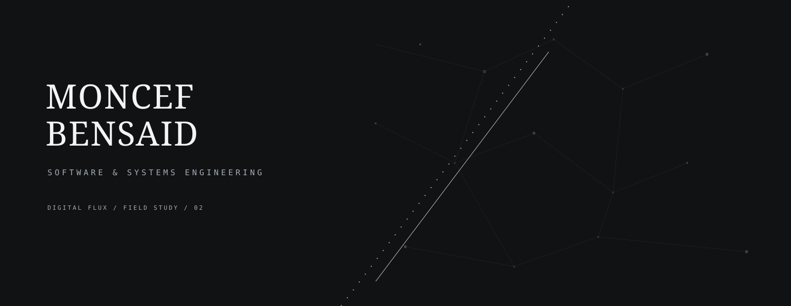
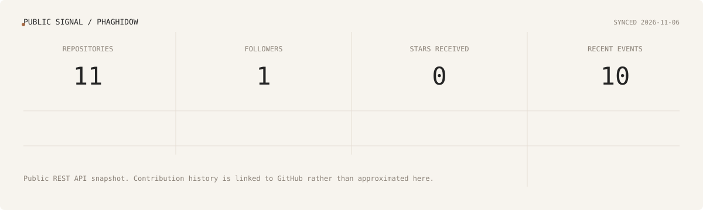

  

  <a href="https://moncef-bensaid.vercel.app">Portfolio</a>
  &nbsp;&nbsp;·&nbsp;&nbsp;
  <a href="https://www.linkedin.com/in/moncef-bensaid/">LinkedIn</a>
  &nbsp;&nbsp;·&nbsp;&nbsp;
  <a href="https://github.com/phaghidow">GitHub</a>

## About

I am **Moncef Bensaid**, a software engineering and information systems student
focused on building useful, reliable, and maintainable digital solutions.

I hold a **Licence in ISIL** (*Ingénierie des Systèmes d'Information et
Logiciels*) and am currently pursuing a **Master 1 in RSE** (*Réseaux et
Systèmes Embarqués*). My work is gradually connecting software development
with networks, embedded systems, and connected technologies.

I am particularly interested in software engineering, IoT, cybersecurity,
artificial intelligence and data science, modern technologies, and system
architecture.

## Technical expertise

| Area | Technologies |
| --- | --- |
| **Languages** | Python · PHP · Java · C · TypeScript · JavaScript · SQL |
| **Frameworks & development** | Laravel · Vue.js · React · FastAPI · Tailwind CSS · PyQt5 |
| **Databases** | MySQL · SQLite · Oracle Database |
| **Tools & environment** | Git · GitHub · Linux · VS Code |

## Selected work

Four projects that represent different parts of my current engineering practice:

### [Project Management System](https://github.com/phaghidow/project-management-pfe)

A Laravel web platform for managing the project lifecycle, including users,
roles, tasks, milestones, dependencies, validation, collaboration, and
traceability.

`Laravel` `PHP` `Vue` `Tailwind CSS` `MySQL / SQLite`

### [Bābil Bookstore](https://github.com/phaghidow/Babil/tree/farid-dev)

A Java Swing desktop bookstore application with a local catalogue, search and
filters, book details, cart and library flows, light/dark themes, and a
simulated checkout.

`Java` `Swing` `SQLite` `JDBC`

### [Procurement Offer Evaluation](https://github.com/phaghidow/Evaluation-Soumissionaires)

A PyQt5 desktop application for managing tender dossiers, technical and
financial evaluation, SQLite persistence, Excel import, audit history, and
Word report export.

`Python` `PyQt5` `SQLite` `openpyxl` `python-docx`

### [Distributed Chat System](https://github.com/phaghidow/SID_Project)

A networking project combining a C TCP authentication server, a C UDP
broadcast server, and C and Java clients with authentication, heartbeats,
message history, and activity logging.

`C` `Java` `TCP/IP` `UDP` `Socket programming`

## GitHub activity

  

  Public GitHub API snapshot · refreshed automatically · <a href="https://github.com/phaghidow">full contribution history</a>

## Connect

If you would like to discuss software engineering, systems, or a project:

- [Portfolio](https://moncef-bensaid.vercel.app/)
- [LinkedIn](https://www.linkedin.com/in/moncef-bensaid/)
- [GitHub](https://github.com/phaghidow)
