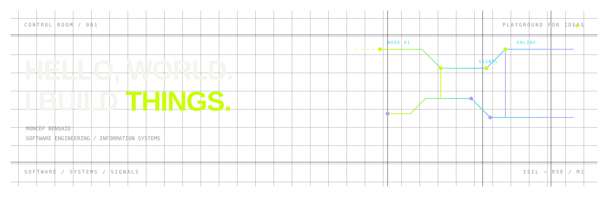

  

  <a href="#live-control-room">CONTROL ROOM</a>
  &nbsp;·&nbsp;
  <a href="#current-experiments">EXPERIMENTS</a>
  &nbsp;·&nbsp;
  <a href="#the-toolbox">TOOLBOX</a>
  &nbsp;·&nbsp;
  <a href="#connect--exit">EXIT</a>

## ENTRY POINT

I’m **Moncef Bensaid** — a software engineering and information systems
student exploring the space between useful software, connected systems, and
the ideas that make both work.

Licence in **ISIL** (*Ingénierie des Systèmes d'Information et Logiciels*).
Currently studying **Master 1 RSE** (*Réseaux et Systèmes Embarqués*).

> Build something useful. Understand how it works. Keep exploring.

## LIVE CONTROL ROOM

  

  <code>PUBLIC API / AUTO-REFRESHED</code>&nbsp;&nbsp; <a href="https://github.com/phaghidow">open full activity graph →</a>

## CURRENT EXPERIMENTS

Not a project catalogue. A few places where I am testing ideas, workflows,
interfaces, and systems.

<strong>01 / PROJECT MANAGEMENT SYSTEM</strong> · Laravel web platform

An application for following a project from creation to closure: users,
roles, tasks, milestones, dependencies, validation, collaboration, and
traceability.

`Laravel` `PHP` `Vue` `Tailwind CSS` `MySQL / SQLite`

→ [open the repository](https://github.com/phaghidow/project-management-pfe)

<strong>02 / BĀBIL</strong> · Java desktop bookstore

A Java Swing catalogue experiment with local books and EPUB editions,
search and filters, details, cart and library flows, light/dark themes, and
a simulated checkout.

`Java` `Swing` `SQLite` `JDBC`

→ [open the repository](https://github.com/phaghidow/Babil/tree/farid-dev)

<strong>03 / PROCUREMENT EVALUATION</strong> · PyQt5 workflow tool

A desktop workflow for tender dossiers, supplier offers, technical
qualification, financial review, Excel import, audit history, and Word
report export.

`Python` `PyQt5` `SQLite` `openpyxl` `python-docx`

→ [open the repository](https://github.com/phaghidow/Evaluation-Soumissionaires)

<strong>04 / DISTRIBUTED CHAT</strong> · C + Java networking study

A networking study combining a C TCP authentication server, a C UDP
broadcast server, and C and Java clients with heartbeats, message history,
and activity logging.

`C` `Java` `TCP/IP` `UDP` `sockets`

→ [open the repository](https://github.com/phaghidow/SID_Project)

## THE TOOLBOX

<code>LANGUAGES</code>

`Python` `PHP` `Java` `C` `TypeScript` `JavaScript` `SQL`

<code>WEB / APPLICATIONS</code>

`Laravel` `Vue.js` `React` `FastAPI` `Tailwind CSS` `PyQt5`

<code>DATA / SYSTEMS</code>

`MySQL` `SQLite` `Oracle Database` `Git` `GitHub` `Linux` `VS Code`

## CURRENTLY EXPLORING

`COMPUTER NETWORKS` · `EMBEDDED SYSTEMS` · `INTERNET OF THINGS`

`CYBERSECURITY` · `ARTIFICIAL INTELLIGENCE` · `SYSTEM ARCHITECTURE`

These are active learning directions, not claims of expertise.

## ACTIVITY SIGNAL

The dashboard above is generated from GitHub’s public REST API by a scheduled
workflow in this repository. It reports public account data only; no
contribution count or streak is approximated locally.

## CONNECT / EXIT

  <a href="https://moncef-bensaid.vercel.app/">PORTFOLIO</a>
  &nbsp;·&nbsp;
  <a href="https://www.linkedin.com/in/moncef-bensaid/">LINKEDIN</a>
  &nbsp;·&nbsp;
  <a href="https://github.com/phaghidow">GITHUB</a>

<code>CONTROL ROOM / playground for ideas / end transmission</code>

