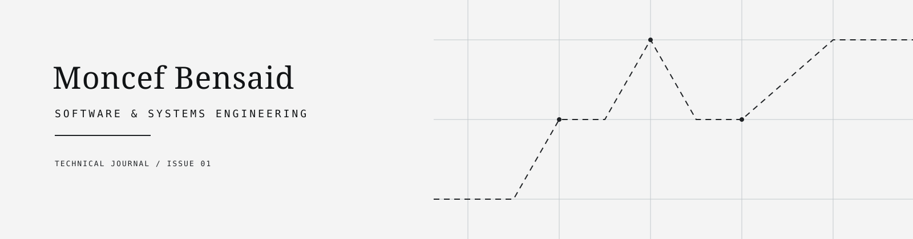

<p align="center">
  <picture>
    <source media="(prefers-color-scheme: dark)" srcset="./assets/journal-header-dark.svg">
    <source media="(prefers-color-scheme: light)" srcset="./assets/journal-header.svg">
    
  </picture>
</p>

<p align="center">
  <a href="#current-explorations">01 / Explorations</a>
  &nbsp;·&nbsp;
  <a href="#workbench">02 / Workbench</a>
  &nbsp;·&nbsp;
  <a href="#activity--journal">03 / Journal</a>
</p>

---

## Identity

### Moncef Bensaid

**Software & Systems Engineering**

> Exploring ideas. Building systems. Understanding technology.

<sub>TECHNICAL JOURNAL / PERSONAL ENGINEERING NOTEBOOK</sub>

## Current Explorations

| 01 | Software Architecture |
|---:|:---|
| 02 | Artificial Intelligence |
| 03 | Embedded Systems |
| 04 | Cybersecurity |
| 05 | Connected Systems / IoT |

<details>
<summary>Notebook note / Note de carnet</summary>

I am interested in the decisions behind reliable software: how systems are structured, how intelligent components behave, and how connected technology meets the real world.

_Comprendre avant de construire. Construire pour apprendre._

</details>

## Workbench

```text
LANGUAGES       Python · PHP · JavaScript · TypeScript · Java
APPLICATIONS    Laravel · Vue.js · React · FastAPI
DATA            MySQL · SQLite
SYSTEMS         Git · Linux · APIs · relational modelling
```

<p>
  
  
  
  
  
  
  
  
  
  
</p>

## Activity / Journal

Development is documented in the repositories below and in the contribution graph maintained by GitHub.

<p align="center">
  
</p>

<p align="center">
  <sub>Observe carefully. Model clearly. Ship deliberately.</sub><br>
  <sub>Observer avec précision. Modéliser clairement. Construire avec intention.</sub>
</p>
