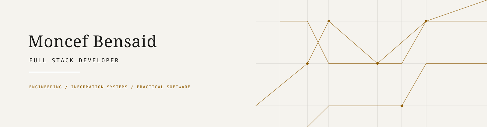

  <picture>
    <source media="(prefers-color-scheme: dark)" srcset="./assets/banner-dark.svg">
    <source media="(prefers-color-scheme: light)" srcset="./assets/banner-light.svg">
    
  </picture>

  

  <a href="https://moncef-bensaid.vercel.app">Portfolio</a>
  &nbsp;·&nbsp;
  <a href="https://www.linkedin.com/in/moncef-bensaid/">LinkedIn</a>
  &nbsp;·&nbsp;
  <a href="https://github.com/phaghidow">GitHub</a>

## 01 / Identity — Identité

**Full Stack Developer** focused on building practical web and desktop software solutions, with an engineering-oriented approach to information systems.

**Développeur Full Stack** orienté vers la conception de solutions web et desktop concrètes, avec une approche d’ingénierie des systèmes d’information.

 

## 02 / About — À propos

I am a student in **Ingénierie des systèmes d'information et logiciels (ISIL)**. I enjoy turning requirements into useful applications: modelling data, structuring APIs, designing interfaces and iterating toward a reliable result.

Je m’intéresse au génie logiciel et aux systèmes d’information, au développement d’applications web et desktop, ainsi qu’à l’architecture, aux technologies émergentes et à la recherche appliquée.

## 03 / Engineering Focus

| Area | Focus |
|---|---|
| **Software Engineering & Full Stack Development** | Designing practical interfaces, REST APIs and end-to-end applications. / Concevoir des interfaces, des APIs REST et des applications de bout en bout. |
| **Data & Information Systems** | Data modelling, business workflows and tools that make information actionable. / Modélisation des données, processus métier et outils utiles à la décision. |
| **Networks, IoT & Cybersecurity** | Academic interests in connected systems, network fundamentals and secure-by-design thinking. / Intérêts académiques pour les systèmes connectés, les réseaux et la sécurité dès la conception. |

## 04 / Technical Stack

**Languages**

&nbsp;
&nbsp;
&nbsp;
&nbsp;
&nbsp;

**Frontend Development**

&nbsp;
&nbsp;
&nbsp;
&nbsp;
&nbsp;

**Backend Development**

`Laravel` · `FastAPI` · `PHP`

**Databases**

`MySQL` · `SQLite`

**Desktop Development**

`PyQt5` · `Java Swing`

**Tools & Environment**

`Git` · `GitHub` · `Figma` · `Bootstrap` · `Vercel`

## 05 / Featured Projects

### [01 — Algérie Télécom / Project Management Platform](https://github.com/phaghidow/project-management-pfe)

Internal project-management platform developed for the Information Systems Division. Covers project lifecycle, tasks, milestones, role-based access control, organizational structure, calendar, Gantt chart, audit log and notifications.

`Laravel` `Vue.js` `JavaScript` `Bootstrap` `MySQL` · **2026 / final-year project**

### [02 — AADL / Supplier Evaluation System](https://github.com/phaghidow/Evaluation-Soumissionaires)

Desktop application for tender and supplier evaluation, with technical and financial workflows, advanced filtering, automated Excel processing, report generation and Word/Excel exports.

`Python` `PyQt5` `SQLite` `Pandas` `OpenPyXL` · **2024 / application delivered for SPA AADL Gest-Immo**

### [03 — PAW / Attendance Management System](https://github.com/phaghidow/PAW_AttendanceSystem)

Full Stack attendance-management application currently in development, with a documented FastAPI REST API, JWT authentication, typed React interface and modules for students, groups, teachers, attendance and schedules.

`FastAPI` `React` `TypeScript` `MySQL` · **2026 / personal project**

More projects / Autres projets

- [Bäbil](https://github.com/phaghidow/Babil) — online library experience designed in Figma and implemented with Java Swing.
- [Tic-Tac-Toe](https://github.com/phaghidow/tictactoe_with_flutter) — first Flutter/Dart mobile project, with local play and a Minimax opponent.

  Precision in the model. Clarity in the interface. Progress through practice. 
  Précision dans le modèle. Clarté dans l’interface. Progrès par la pratique.

