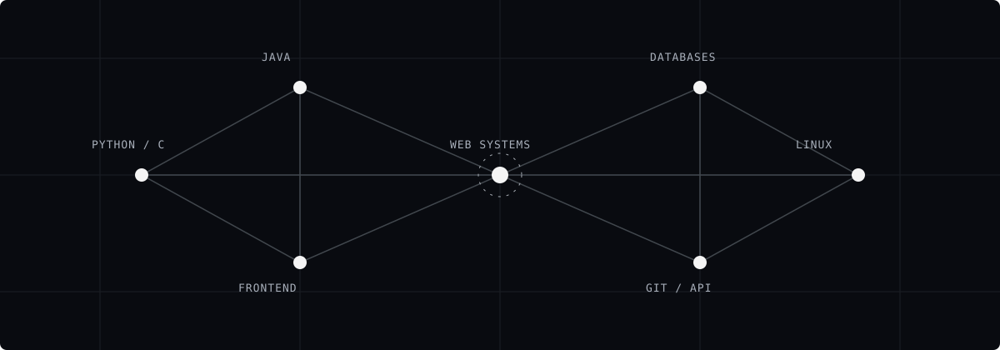

  

  <a href="#technical-universe">TECHNICAL UNIVERSE</a>
  &nbsp;·&nbsp;
  <a href="#development-trace">DEVELOPMENT TRACE</a>

---

## Technical Universe

  

  Software engineering · Artificial intelligence · Embedded systems · Cybersecurity · Connected systems

## Development Trace

<a href="https://github.com/phaghidow">OPEN PROFILE / VIEW CONTRIBUTION GRAPH →</a>

  <a href="https://github.com/phaghidow">GITHUB</a>
  &nbsp;·&nbsp;
  <a href="https://moncef-bensaid.vercel.app">PORTFOLIO</a>
  &nbsp;·&nbsp;
  <a href="https://www.linkedin.com/in/moncef-bensaid/">LINKEDIN</a>

  Exploring ideas. Building systems. Understanding technology. 
  Moins d'explications. Plus d'expression.

